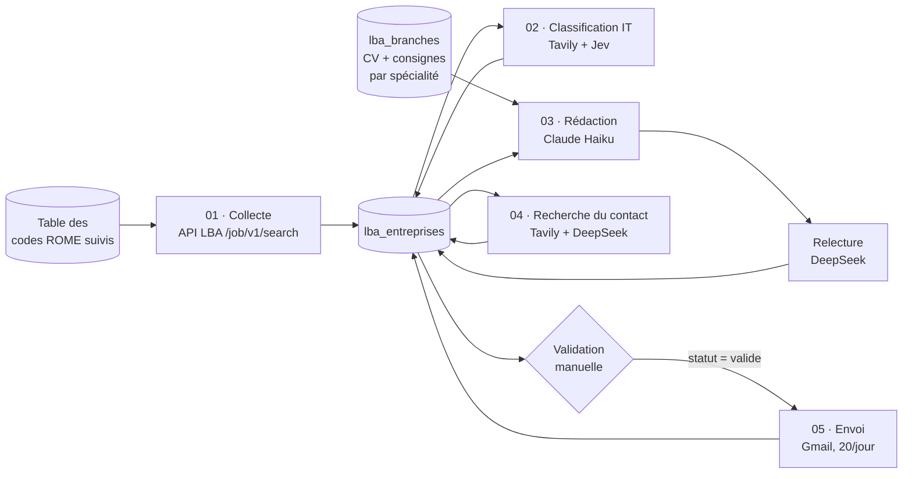

# LBA – Automatisation des candidatures spontanées

> **Vous arrivez ici depuis mon message de candidature ?**
> Bonjour ! Oui, le message que vous avez reçu a été envoyé par ce projet. Je cherche une alternance en informatique (développement d'application, réseau-infra, cybersécurité, QA ...) pour 2026-2027 et, plutôt que d'envoyer des candidatures génériques, j'ai construit cet outil : il repère les entreprises susceptibles de recruter, fait une recherche sur chacune, les trie par spécialité, rédige un message adapté que je relis, puis l'envoie. Le schéma ci-dessous montre comment ça marche, et [`docs/journal.md`](docs/journal.md) raconte la construction, problèmes compris.
> Pour me répondre, il suffit de répondre au message reçu.
> — Gauthier Faisandaz

Pipeline n8n qui repère les entreprises susceptibles de recruter en alternance sur [La bonne alternance](https://labonnealternance.apprentissage.beta.gouv.fr/) (LBA), les classe, trouve comment les contacter, rédige un message de candidature personnalisé pour chacune et l'envoie par email.

Projet personnel mené dans le cadre de ma recherche d'alternance (bassin Lens / Béthune / Lille) en informatique. L'objectif est de faire du volume **sans sacrifier la personnalisation** : chaque message est rédigé à partir de l'activité réelle de l'entreprise et relu avant envoi.

## Architecture

Ordre d'exécution : 01 → 02 → 04 → 03 → validation → 05. La rédaction ne traite que les entreprises dont un contact a été trouvé.

Le suivi repose sur deux colonnes : `contact_statut` (`email` / `formulaire` / `sans_contact`) et `statut` : `a_traiter` → `brouillon` (ou `a_revoir` si la relecture échoue ou rejette le message) → `valide` → `envoyee`. Les entreprises qui n'ont qu'un formulaire de contact sont traitées à la main, avec le message rédigé.

## Workflows

| Fichier | Rôle | État |
|---|---|---|
| `workflows/00_configuration_branches.json` | Point d'édition des branches : pour chaque spécialité (développement, data/IA, cybersécurité, systèmes et réseaux), le CV à joindre, la cible d'alternance, les consignes de rédaction et un interrupteur `actif`. Écrit dans la table `lba_branches`. | Opérationnel |
| `workflows/01_collecte_entreprises.json` | Interroge l'API LBA pour chaque code ROME suivi, garde les entreprises « candidature spontanée » (sans offre publiée), dédoublonne sur le SIRET et insère uniquement les nouvelles. | Opérationnel |
| `workflows/02_classification_specialite_it.json` | Pour les entreprises informatiques : recherche web (Tavily, annuaires exclus), puis décision par **Jev** (TypeSafe, via OpenRouter) : spécialité (développement, réseau/support, cybersécurité, data, ERP/conseil, ESN généraliste, non IT) avec un score de confiance, et vérification que les résultats web concernent bien la bonne entreprise. | Opérationnel |
| `workflows/03_redaction_candidatures_it.json` | Pour chaque entreprise joignable, classée avec une confiance ≥ 0,7, dont la spécialité a une branche active : récupère le CV de la branche (Google Drive), rédige le message avec **Claude Haiku 5.5**, le fait relire par une seconde IA d'un autre éditeur (**DeepSeek V4.1 Flash**), qui renvoie un verdict (`ok` / `corrige` / `rejete`) et les problèmes relevés, puis enregistre le tout avec un objet d'email. | Opérationnel, en phase de calibration |
| `workflows/04_recherche_contact.json` | Recherche web (Tavily, contenu brut des pages), puis extraction par **DeepSeek** du site officiel, de l'email de recrutement ou à défaut de contact, et du formulaire. Un email n'est retenu que s'il apparaît tel quel dans les pages : pas d'adresse devinée. | Construit, non testé |
| `workflows/05_envoi_gmail.json` | Envoie une à une, depuis Gmail, les candidatures validées à la main, avec en pièce jointe le CV qui a servi à rédiger le message, en texte brut ; 20 créneaux par jour en semaine ; marque la ligne `envoyee` avec la date. | Construit, inactif |

### Import

1. Importer les JSON dans n8n.
2. Remplacer les valeurs `REPLACE_ME` (credentials), `ID_TABLE_LBA_ENTREPRISES`, `ID_TABLE_LBA_BRANCHES`, `ID_TABLE_CODES_ROME` et les `ID_CV_…_SUR_GOOGLE_DRIVE`.
3. Lancer `00_configuration_branches` une fois pour remplir `lba_branches`.
4. Dans `05_envoi_gmail`, renseigner nom, téléphone et profil en signature.
5. Créer les credentials : clé API LBA (Header Auth `Authorization: Bearer …`), Tavily, OpenRouter, Google Drive.

## Table `lba_entreprises`

| Colonne | Type | Contenu |
|---|---|---|
| `siret` | string | Clé de dédoublonnage |
| `nom`, `adresse`, `taille`, `secteur_naf` | string | Données LBA |
| `type_opportunite` | string | `candidature_spontanee` (ou `offre`, branche à venir) |
| `code_rome` | string | Premier code ROME sur lequel l'entreprise est remontée |
| `candidature_simplifiee`, `recipient_id` | boolean, string | Bouton « candidature simplifiée » de LBA (informatif : l'envoi ne passe pas par LBA) |
| `contact_statut` | string | `email`, `formulaire` ou `sans_contact` |
| `email_contact`, `formulaire_url`, `contact_source` | string | Adresse retenue, formulaire éventuel, page où l'adresse a été trouvée |
| `objet_email` | string | Objet de l'email, selon la branche |
| `cv_drive_id` | string | CV utilisé pour rédiger le message, joint tel quel à l'envoi |
| `date_envoi`, `gmail_message_id` | date, string | Trace de l'envoi |
| `lien_lba` | string | Fiche de l'entreprise sur LBA |
| `site_web`, `telephone` | string | Rarement fournis par LBA ; `site_web` est complété par la classification |
| `specialite` | string | Spécialité choisie par Jev (`inconnu` si les résultats web ne concernent pas l'entreprise) |
| `specialite_confiance` | number | Confiance de Jev (0–1) ; en dessous de 0,7, l'entreprise est à vérifier à la main |
| `resume_activite`, `contexte_web` | string | Résumé et extraits de la recherche web, réutilisés pour la rédaction |
| `classifie_par` | string | Version du modèle ayant classé la ligne |
| `message_initial` | string | Message tel que rédigé par la première IA |
| `message_brouillon` | string | Message après relecture (celui qui sera envoyé) |
| `relecture_verdict`, `relecture_notes` | string | Verdict de la seconde IA et problèmes relevés |
| `statut` | string | `a_traiter` / `brouillon` / `a_revoir` / `valide` / `envoyee` |
| `application_id` | string | Identifiant renvoyé par l'API après envoi |
| `date_collecte` | date | Date d'insertion |

## Ce que j'ai appris de l'API La bonne alternance

- **Recherche** (`GET /api/job/v1/search`, paramètres `romes`, `latitude`, `longitude`, `radius`) : la réponse contient `jobs` (offres) et `recruiters` (entreprises sans offre, jugées susceptibles de recruter).
- **Plafond de 150 résultats par source**, triés par distance : sur un rayon de 50 km on récupère en réalité les 150 entreprises les plus proches par code ROME.
- **Candidature simplifiée = présence de `apply.recipient_id`.** Environ une entreprise sur deux en a un, avec de fortes variations selon le code ROME.
- `website` et `phone` sont presque toujours vides : il faut une étape de recherche pour trouver le site.
- Le ciblage par code ROME est large : un code « informatique » remonte aussi des commerces, des holdings ou des entreprises dont l'informatique n'est pas le métier, d'où l'intérêt d'une classification.
- **Envoi** (`POST /api/job/v1/apply`) : réservé aux plateformes partenaires. L'habilitation `applications:write` m'a été refusée pour un usage individuel : les candidatures partent donc par email, directement aux entreprises.
- Usage réservé aux projets non commerciaux.

## Résultats à ce stade

- Près de **500 entreprises du secteur informatique** repérées autour de Lens / Béthune / Lille (codes ROME et codes NAF informatiques).
- 85 entreprises informatiques classées par Jev pour environ 0,005 $ au total : 20 réseau/support, 22 hors IT, 12 développement (dont 8 avec une confiance ≥ 0,7), 9 ERP/conseil, 7 ESN généralistes, 4 cybersécurité, 3 data, 8 inconnues.
- Premiers brouillons de messages générés et relus.

Le détail des étapes, des problèmes rencontrés et des choix faits est dans [`docs/journal.md`](docs/journal.md).

## Stack

n8n (data tables, nœuds natifs, chaînes LLM) · API La bonne alternance · Tavily · OpenRouter (Jev de TypeSafe pour la classification, Claude Haiku 5.5 pour la rédaction, DeepSeek V4.1 Flash pour la relecture et l'extraction des contacts) · Gmail · Google Drive
